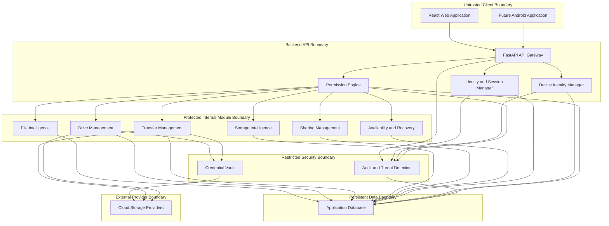

# PSI Security Boundaries

**Status:** Phase 2.1 — Design documentation
**Implementation status:** Proposed architecture; boundaries are not yet enforced by implemented security modules.

## 1. Purpose

This document defines the trust boundaries between PSI clients, backend security components, business modules, persistent storage and external storage providers.

The purpose is to prevent unauthorized access, privilege escalation, credential exposure and uncontrolled communication between components.

## 2. Boundary principles

- Every boundary must have a clearly defined owner and responsibility.
- The frontend is an untrusted environment.
- Authentication and authorization decisions belong on the backend.
- Modules must communicate through documented interfaces.
- Sensitive credentials must remain inside the backend credential-protection boundary.
- External providers must never be trusted merely because they are connected.
- Security failures must not silently grant access.
- Sensitive operations must be attributable to an identity and recorded in the audit system.

## 3. Trust boundary diagram

**Diagram note:** This is a logical design, not an implemented deployment diagram. Actual module interfaces, database ownership and provider communication paths will be finalized during implementation.

## 4. Boundary definitions

### 4.1 Client-to-backend boundary

**Components:** React web application, future Android application and FastAPI backend.

Trust level: The client is untrusted.

Required controls:

- Use HTTPS in deployed environments.
- Validate all request data on the backend.
- Never trust client-supplied roles or permission decisions.
- Do not expose provider credentials or private keys to frontend code.
- Apply authentication and authorization to protected endpoints.
- Protect browser sessions against CSRF and session theft.
- Return only information the requesting identity is authorized to access.

A hidden frontend button or disabled menu item is not an authorization control.

### 4.2 Identity boundary

**Components:** Identity Gateway, Identity Manager and Session Manager.

Responsibilities:

- Establish the authenticated principal.
- Validate authentication evidence.
- Validate session status and expiry.
- Reject disabled or revoked identities.
- Maintain account and session lifecycle.
- Pass verified identity context to authorization components.

Business modules must not independently invent or accept an unverified identity.

### 4.3 Device identity boundary

**Components:** Device Identity Manager and registered client devices.

Responsibilities:

- Register device public keys.
- Verify cryptographic challenges.
- Associate sessions with registered devices.
- Track device status.
- Revoke compromised or untrusted devices.
- Invalidate associated sessions after revocation.

Private keys must remain on their devices.

IP addresses and browser fingerprints may contribute risk signals but must not independently establish device identity.

### 4.4 Authorization boundary

**Components:** Permission Engine and business modules.

Responsibilities:

- Evaluate role permissions.
- Evaluate resource-specific grants.
- Check action restrictions.
- Enforce expiry and scheduling.
- Enforce device restrictions.
- Require approval for sensitive operations where configured.

Every protected operation must be authorized by the backend before execution.

### 4.5 Business-module boundary

**Components:** File Intelligence, Drive Management, Transfer Management, Storage Intelligence, Sharing Management and Availability & Recovery.

Rules:

- Each module owns its business logic.
- Modules use documented interfaces to request other modules' capabilities.
- Modules must not directly modify another module's internal data.
- A module must not bypass the Permission Engine for protected user actions.
- Background jobs must retain attributable identity and authorization context.
- Failed or incomplete operations must not be reported as successful.

### 4.6 Credential boundary

**Components:** Credential Vault and authorized backend services.

Rules:

- Only authorized backend components may request credential operations.
- Provider tokens must not be returned to the frontend.
- Credentials must be encrypted before persistent storage.
- Encryption keys must be managed separately from encrypted credential data.
- Secrets must not appear in logs, audit records, exception messages or API responses.
- Credential access must be attributable and auditable.

Provider credentials are not configured in Phase 2.1.

### 4.7 Persistent-data boundary

**Components:** Application database and approved data-access interfaces.

Rules:

- Database access must use least-privilege service permissions.
- Sensitive fields must receive appropriate protection.
- Access to security records must be restricted.
- Database errors must not expose credentials or internal secrets.
- Database backups must be protected.
- Database compromise must be included in the threat model.

PostgreSQL remains planned and is not configured in the current project foundation.

### 4.8 External-provider boundary

**Components:** Google Drive, OneDrive, Dropbox and future storage providers.

Rules:

- Treat provider responses and remote files as untrusted input.
- Use minimum required OAuth scopes.
- Protect refresh tokens in the Credential Vault.
- Validate provider operations and results.
- Verify transfers before updating PSI's official file-location records.
- Handle expired tokens, rate limits, outages and permission failures.
- Do not assume a provider's availability guarantees file availability in PSI.

No provider integration is implemented in Phase 2.1.

## 5. Sensitive operation boundary

The following operations require explicit authorization and, where policy requires, additional owner approval:

- Changing account security settings.
- Registering or approving a new trusted device.
- Granting Administrator privileges.
- Changing resource permissions.
- Creating or changing invitations.
- Changing a recipient's OTP destination.
- Accessing or rotating provider credentials.
- Revoking devices or sessions.
- Sharing files externally.
- Deleting source files after migration.
- Performing recovery actions that change official file locations.

Approval must be recorded and associated with the operation.

## 6. Background-job security

Background jobs must not bypass normal security rules.

Each job should retain:

- Job identifier.
- Initiating identity.
- Initiating device or session reference, when applicable.
- Requested operation.
- Resource scope.
- Authorization decision reference.
- Creation time.
- Execution status.
- Completion or failure result.

A job must revalidate relevant permissions before a sensitive execution step, especially when permissions or device status may have changed after scheduling.

Revoked access must prevent future unauthorized job execution.

## 7. Boundary failure rules

PSI must fail securely when:

- Identity cannot be established.
- Session validation fails.
- Device proof is invalid.
- Permission evaluation fails.
- A required approval is missing.
- Credential integrity verification fails.
- A provider response cannot be validated.
- A transfer cannot be verified.
- A required audit operation fails under the applicable security policy.

Failure must not result in silent access or a false success response.

## 8. Related documents

- `docs/architecture/overview.md`
- `docs/security/architecture.md`
- `docs/security/threat-model.md`
- `docs/security/identity-and-access.md`
- `docs/security/device-identity.md`
- `docs/security/credential-vault.md`
- `docs/security/sessions.md`
- `docs/security/audit-and-detection.md`
- `docs/security/testing-strategy.md`
